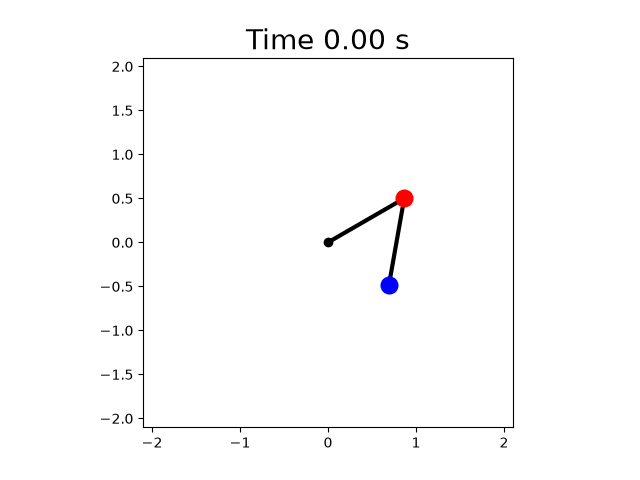

# Double Pendulum

A Python simulation of a double pendulum using the equations of motion derived from Lagrangian mechanics.

## Simulation



## Installation

### Requirements

- Python 3
- NumPy
- Matplotlib

Clone the repository:

```bash
git clone https://github.com/OrestasP/Double-Pendulum.git
cd Double-Pendulum
```

Create a virtual environment and install dependencies:

```bash
python3 -m venv .venv
source .venv/bin/activate
python -m pip install -r requirements.txt
```

## Running the simulation

```bash
python pendulum/main.py
```
To change pendulum's starting conditions, change it at pendulum/pendulums.py

## Current Progress

- [x] Project plan
- [x] Double pendulum equations of motion
- [x] Numerical integration with RK4
- [x] Trajectory plots
- [x] Energy conservation analysis
- [x] Animation
- [ ] Chaos analysis

## Project Plan

See [Plan.md](Plan.md) for the full development roadmap.
